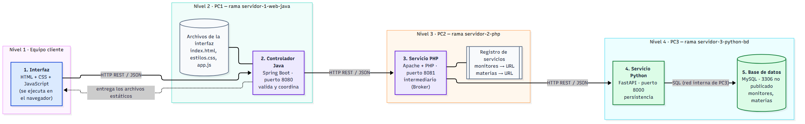
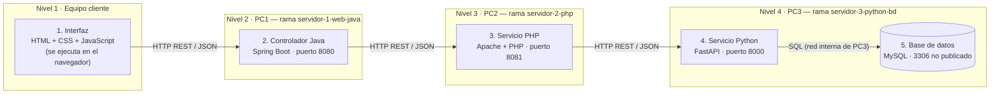
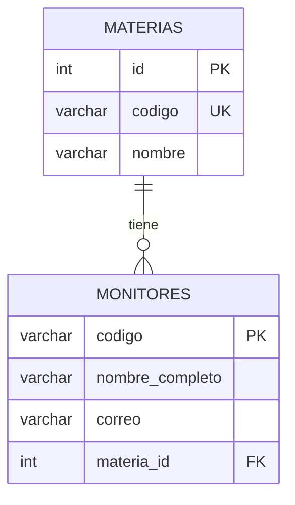
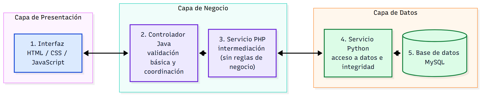
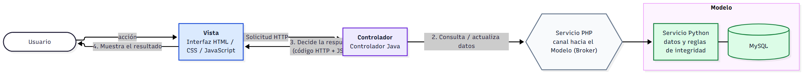
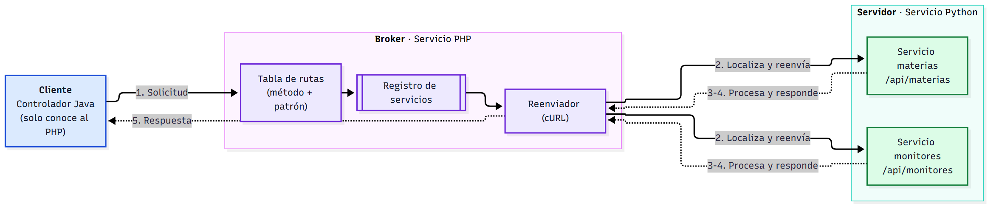

# Arquitectura del sistema

Sistema de gestión de monitores académicos de la Universidad de Caldas. Es una aplicación web **distribuida** (se ejecuta en varios equipos), **multicapa** (cada componente tiene una responsabilidad y solo habla con su vecino) y **heterogénea** (cada componente está hecho en un lenguaje distinto).

## 1. Diagrama de arquitectura

Los archivos de la interfaz (HTML, CSS y JavaScript) están **alojados** en PC1 y los entrega el mismo servidor Java, pero **se ejecutan en el navegador** del usuario. Por eso la interfaz aparece en el equipo cliente.

## 2. Componentes y responsabilidades

| # | Componente | Tecnología | Dónde corre | Responsabilidad | Lo que **no** hace |
|---|---|---|---|---|---|
| 1 | Interfaz | HTML, CSS y JavaScript puros | Navegador del usuario (archivos alojados en PC1) | Formularios y tablas; captura las acciones del usuario, llama al Controlador Java con `fetch` y muestra los resultados y errores | No conoce al PHP, al Python ni a la base de datos |
| 2 | Controlador Java | Java 21, Spring Boot | PC1, puerto 8080 | Recibe las solicitudes de la interfaz, valida la información básica (campos completos y con formato correcto) y envía la petición al PHP | No guarda datos ni conoce al Python o a la base de datos |
| 3 | Servicio PHP | PHP 8.3 sobre Apache | PC2, puerto 8081 | Intermediario: recibe la petición de Java, busca en su registro qué servidor atiende ese recurso y la reenvía al Python; devuelve la respuesta tal como llega | No valida reglas de negocio ni accede a la base de datos |
| 4 | Servicio Python | Python 3.12, FastAPI, SQLAlchemy | PC3, puerto 8000 | Persistencia: ejecuta las consultas y modificaciones, y hace cumplir la integridad (código duplicado, materia inexistente, registro no encontrado) | No atiende al navegador |
| 5 | Base de datos | MySQL 8.4 | PC3, solo en la red interna de Docker | Almacena las tablas `monitores` y `materias` | No es alcanzable desde fuera de PC3 |

Regla que se cumple en todas las operaciones (incluida la lista de materias del formulario): **cada componente solo se comunica con el siguiente de la cadena**. La interfaz nunca accede directamente a la base de datos.

### Modelo de datos

## 3. Capas y niveles

Las dos palabras no significan lo mismo: una **capa** es una división **lógica** (qué hace cada parte) y un **nivel** es una división **física** (en qué equipo se ejecuta cada parte).

### Capas (división lógica)

El sistema tiene cinco componentes encadenados de forma estricta, que se agrupan en las tres capas clásicas:

| Capa | Componentes | Por qué pertenecen a esa capa |
|---|---|---|
| Presentación | 1. Interfaz | Es lo que ve el usuario: presenta la información y captura sus solicitudes |
| Negocio | 2. Controlador Java y 3. Servicio PHP | Java recibe las peticiones del usuario, aplica las reglas de validación y coordina la operación. PHP es una capa de intermediación dentro del negocio: no tiene reglas propias, coordina la comunicación con el servicio que resuelve la petición |
| Datos | 4. Servicio Python y 5. MySQL | Python es el componente de acceso a datos (el enunciado le asigna "las operaciones de persistencia") y MySQL es el gestor que almacena la información |

La validación de código duplicado es una **restricción de integridad de la capa de datos** (llave primaria). El Controlador Java no puede hacerla porque no tiene los datos; por eso el duplicado lo detecta Python/MySQL y la respuesta `409` viaja de regreso por toda la cadena.

### Niveles (división física)

| Escenario | Niveles | Detalle |
|---|---|---|
| Demostración con el navegador en otro equipo | **4** | Cliente, PC1, PC2 y PC3 |
| Demostración abriendo el navegador en PC1 | **3** | PC1 (cliente + Java), PC2 y PC3 |
| Prueba local con los tres `docker compose` en un mismo computador | **1** | Las mismas capas en un solo equipo |

Aclaraciones:

- El servicio Python y MySQL corren en contenedores distintos, pero en el mismo computador (PC3): son **un solo nivel**.
- Una rama de git o un contenedor no son ni una capa ni un nivel; son la forma de organizar y empaquetar el código.
- La prueba local demuestra que las capas no dependen del despliegue: son las mismas cinco, estén en un equipo o en cuatro.

## 4. Arquitecturas, estilos y patrones presentes

Resumen:

| Tipo | Nombre | Componentes que participan |
|---|---|---|
| Patrón arquitectónico (POSA) | Capas (Layers) | Los cinco |
| Patrón arquitectónico (POSA) | MVC (Modelo–Vista–Controlador) | Interfaz, Controlador Java, Servicio Python y MySQL |
| Patrón arquitectónico (POSA) | Broker | Controlador Java, Servicio PHP y Servicio Python |
| Modelo de arquitectura | Cliente–Servidor | Cada par de componentes vecinos |
| Forma de despliegue | Arquitectura de N niveles | Equipo cliente, PC1, PC2 y PC3 |
| Estilo arquitectónico | REST | Interfaz, Java, PHP y Python |

### 4.1 Patrón de Capas (Layers)

**Características.** Organiza el sistema en capas con responsabilidades específicas. Cada capa se comunica solo con la capa adyacente: usa los servicios de la que tiene debajo y le presta servicios a la que tiene encima. Facilita el mantenimiento, permite desarrollar en paralelo, aumenta la reutilización y reduce el impacto de los cambios. Puede implementarse en un solo equipo o distribuirse en varios.

**Componentes que participan.** Los cinco, en este orden: Interfaz → Controlador Java → Servicio PHP → Servicio Python → MySQL (agrupados en Presentación, Negocio y Datos como se indicó arriba).

**Justificación.**

- Cada componente tiene una única responsabilidad y ninguno hace el trabajo de otro.
- La comunicación es estrictamente entre vecinos: no existe ninguna llamada que se salte una capa. Se puede comprobar en el código (la interfaz solo usa rutas relativas hacia Java; Java solo conoce la URL del PHP; PHP solo conoce la URL del Python; solo Python tiene las credenciales de la base de datos) y en la red (el puerto de MySQL no está publicado).
- Se puede cambiar una capa sin tocar las demás mientras respete el contrato REST. Por ejemplo, reemplazar MySQL por otro gestor solo afecta al servicio Python.
- Las tres ramas se desarrollaron en paralelo a partir del mismo contrato de endpoints, que es justamente una de las ventajas del patrón.

### 4.2 Patrón MVC (Modelo–Vista–Controlador)

**Características.** Separa la aplicación en tres componentes: el **Modelo** representa los datos, la lógica y el acceso a la fuente de datos (base de datos, archivos, servicios); la **Vista** es la interfaz de usuario; el **Controlador** recibe las solicitudes del usuario, coordina el flujo, invoca al Modelo y determina la respuesta. Define la secuencia de ejecución desde que ocurre un evento en la presentación hasta que es atendido por completo.

**Componentes que participan.**

| Rol | Componente |
|---|---|
| Vista | Interfaz HTML/CSS/JavaScript |
| Controlador | Controlador Java |
| Modelo | Servicio Python + MySQL (datos, acceso a datos y reglas de integridad) |

**Justificación.**

- El flujo del sistema es el del patrón: (1) el usuario realiza una acción en la interfaz; (2) el Controlador recibe la solicitud y consulta o actualiza la información en el Modelo; (3) el Controlador decide la respuesta; (4) la Vista muestra el resultado.
- Es la variante **web** de MVC: la Vista nunca consulta directamente al Modelo; todo pasa por el Controlador. No se usa el MVC clásico (en el que la Vista consulta al Modelo y este le notifica los cambios) porque el enunciado prohíbe que la interfaz acceda directamente a los datos.
- "El Controlador selecciona la Vista" se cumple así: el Controlador Java decide qué representación devolver (el código HTTP y el JSON de éxito o de error) y con eso la interfaz decide qué pintar: la tabla actualizada, el formulario con errores o un mensaje.
- El Controlador alcanza al Modelo **a través de servicios**: el Servicio PHP no es Modelo, Vista ni Controlador; es el canal de comunicación entre el Controlador y el Modelo (patrón Broker). MVC y Broker resuelven problemas distintos y conviven.
- La validación básica está en el Controlador porque así lo pide el enunciado; las reglas que dependen de los datos (duplicados, materia existente) están en el Modelo.
- Limitación reconocida: en el navegador, `app.js` reúne el dibujo de la vista y la captura de los eventos del usuario; el control de la aplicación (validar, coordinar y decidir la respuesta) sí está en Java.

### 4.3 Patrón Broker

**Características.** Un intermediario (broker) se ubica entre los clientes y un conjunto de servidores, y encapsula la localización, la comunicación y la invocación de los servicios en un entorno distribuido y heterogéneo. El cliente solicita servicios sin conocer su ubicación; el broker localiza el servidor adecuado, reenvía la solicitud y devuelve la respuesta. Favorece el desacoplamiento, esconde detalles de implementación y da flexibilidad para añadir, quitar o reubicar servicios.

**Componentes que participan.**

| Rol en el patrón | Componente |
|---|---|
| Cliente | Controlador Java (solo conoce la dirección del PHP) |
| Proxy del lado del cliente | Clase `ServicioPhpClient` del Controlador Java (oculta los detalles de la llamada HTTP) |
| Broker | Servicio PHP: tabla de rutas, registro de servicios y reenviador |
| Proxy del lado del servidor | Rutas (routers) del servicio Python, que traducen la petición HTTP en una operación |
| Servidor | Servicio Python, que ofrece los servicios `monitores` y `materias` |

**Justificación.**

- El Servicio PHP sigue el flujo del patrón: (1) recibe la solicitud del cliente; (2) identifica en su **registro de servicios** qué servidor atiende ese recurso y reenvía la solicitud; (3) el servidor la procesa; (4) el servidor devuelve el resultado al broker; (5) el broker devuelve la respuesta al cliente.
- **Transparencia de localización:** Java no sabe dónde está el Python. Si el servicio Python cambia de equipo, de IP o de puerto, solo se cambia la configuración del PHP; Java y la interfaz no se tocan.
- **Heterogeneidad:** permite que un cliente en Java use servicios hechos en Python sin que ninguno conozca la tecnología del otro; se entienden por HTTP y JSON.
- El registro tiene una entrada independiente por servicio (`monitores` y `materias`), cada una con su propia dirección. En este despliegue ambas apuntan a PC3, pero cada servicio podría moverse a un servidor distinto sin cambiar a los clientes. Si se pide un recurso que no está registrado, el broker responde `404`.

**Alcance.** Es un Broker simplificado. No se implementa el registro dinámico (los servidores no se inscriben solos; el registro es un archivo de configuración), hay un solo servidor detrás y no hay puentes entre varios brokers. También se asumen las desventajas propias del patrón: el broker es un punto único de falla, puede convertirse en cuello de botella y agrega latencia a cada operación.

### 4.4 Modelo Cliente–Servidor

**Características.** Uno o varios clientes solicitan recursos o servicios y un servidor los procesa y responde. La comunicación se hace a través de una red y siempre la inicia el cliente.

**Componentes que participan.** El sistema es una cadena de relaciones cliente–servidor:

| Cliente | Servidor |
|---|---|
| Navegador (interfaz) | Controlador Java |
| Controlador Java | Servicio PHP |
| Servicio PHP | Servicio Python |
| Servicio Python | MySQL |

**Justificación.** En cada enlace hay un componente que pide y otro que atiende, y la respuesta siempre regresa por el mismo camino. Java, PHP y Python tienen **doble rol**: son servidores del componente anterior y clientes del siguiente. Solo el extremo de la cadena (PC3) responde con sus propios recursos; los intermedios necesitan de otra aplicación para dar el servicio, y por eso el sistema no es una arquitectura cliente–servidor de 2 niveles sino de N niveles.

### 4.5 Arquitectura de N niveles

**Características.** Incorpora niveles intermedios entre el cliente y los datos; cada servidor se especializa en una tarea. Frente a dos niveles ofrece mayor flexibilidad, seguridad (se define por nivel) y mejor reparto de la carga, a cambio de mayor complejidad.

**Componentes que participan.** Equipo cliente (navegador), PC1 (Controlador Java), PC2 (Servicio PHP) y PC3 (Servicio Python y MySQL).

**Justificación.** Las capas lógicas están repartidas físicamente en varios computadores conectados por red: 4 niveles cuando el navegador está en un equipo aparte. La seguridad se define por nivel: la base de datos solo es visible dentro de PC3.

### 4.6 Estilo REST

**Características.** Los servicios exponen **recursos** identificados por URL (`/api/monitores`, `/api/monitores/{codigo}`, `/api/materias`); las operaciones se expresan con los métodos HTTP (`GET`, `POST`, `PUT`, `DELETE`); el resultado se comunica con códigos de estado (`200`, `201`, `204`, `400`, `404`, `409`); los datos viajan en JSON y cada petición es independiente (sin estado en el servidor).

**Componentes que participan.** Interfaz, Controlador Java, Servicio PHP y Servicio Python (los tres saltos HTTP).

**Justificación.** Es el mecanismo de comunicación que exige el enunciado y el que hace posible la heterogeneidad: los tres servicios exponen el mismo contrato (ver [03-endpoints.md](03-endpoints.md)) sin importar el lenguaje en que están hechos. El único enlace que no es REST es el de Python con MySQL, que usa SQL porque es el acceso a datos.
