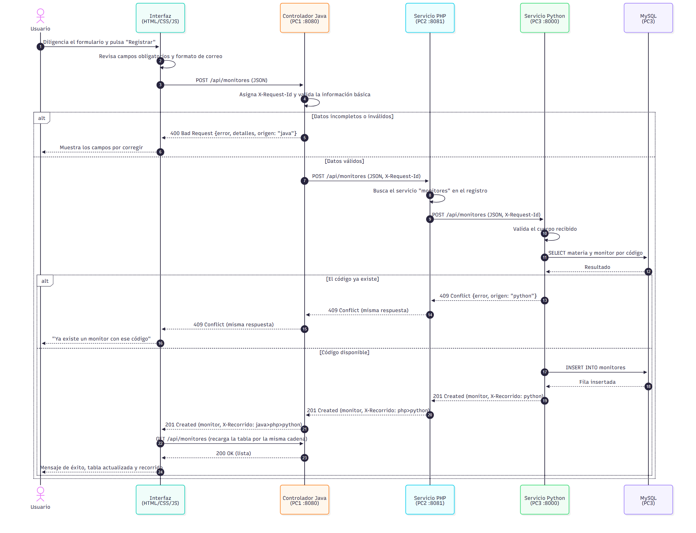
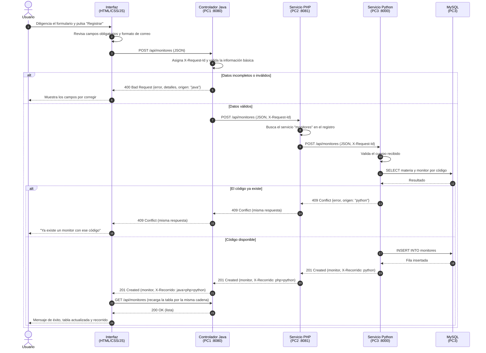

# Diagrama de secuencia: registro de un monitor

Muestra el recorrido completo de la operación **RF1 – Registrar monitores**, desde que el usuario pulsa "Registrar" hasta que ve el resultado, incluyendo los dos casos de error del requisito **RF6** (registro incompleto y código duplicado).

## Descripción del flujo

### Flujo principal (registro exitoso)

1. El usuario llena el formulario (código, nombre completo, correo y materia) y pulsa **Registrar**.
2. La interfaz revisa que no haya campos vacíos y que el correo tenga formato válido. Es solo una ayuda para el usuario; la validación que cuenta es la de los servicios.
3. La interfaz envía `POST /api/monitores` al Controlador Java con los datos en JSON.
4. El Controlador Java asigna un identificador a la petición (`X-Request-Id`) y valida la información básica: campos obligatorios, longitudes y formato.
5. Java envía la petición al Servicio PHP.
6. El Servicio PHP busca en su registro qué servidor atiende el recurso `monitores` y reenvía la petición al Servicio Python sin modificarla.
7. El Servicio Python valida el cuerpo, verifica que la materia exista y que el código no esté registrado.
8. Python inserta el registro en MySQL.
9. La respuesta `201 Created` con el monitor creado regresa por el mismo camino: Python → PHP → Java → Interfaz. Cada servicio agrega su nombre al encabezado `X-Recorrido`.
10. La interfaz muestra el mensaje de éxito, vuelve a consultar la lista (por la misma cadena) y actualiza la tabla.

### Flujo alterno A: registro incompleto o inválido

El Controlador Java detecta el problema en el paso 4 y responde `400 Bad Request` con el detalle de cada campo. **La petición no llega al PHP ni al Python**: el recorrido termina en `java`.

### Flujo alterno B: código duplicado

Los datos son válidos, así que la petición llega hasta el Servicio Python. Allí se detecta que el código ya existe (verificación previa y llave primaria de la tabla) y se responde `409 Conflict`. PHP y Java devuelven esa misma respuesta sin alterarla y la interfaz muestra el mensaje al usuario.

### Fallas de comunicación

Si el servicio siguiente no está disponible, el componente que lo detecta responde `502 Bad Gateway` (o `504 Gateway Timeout` si no contestó a tiempo) con el mismo formato de error, y la interfaz informa en qué punto de la cadena se presentó la falla.
